Towards GitHub

---

## Part One: Introduction: Towards GitHub 


here is the logo of GitHub

### 1. What Is GitHub? 

GitHub is a code hosting and collaboration platform built on the **Git** version control system. It launched in 2008 and was acquired by Microsoft in 2018. Simply put, it is a website for "storing code and writing code with others."

!!! tip
    GitHub is different from Git. GitHub is an open-source platform whose repositories are based on Git. You can also find unexpected things on GitHub, even if they have nothing to do with coding.
    In theory, you can upload anything you want to share.

**some interesting examples**

- [Free Programming Books](https://github.com/EbookFoundation/free-programming-books): A community-maintained collection of free programming books and learning resources.

    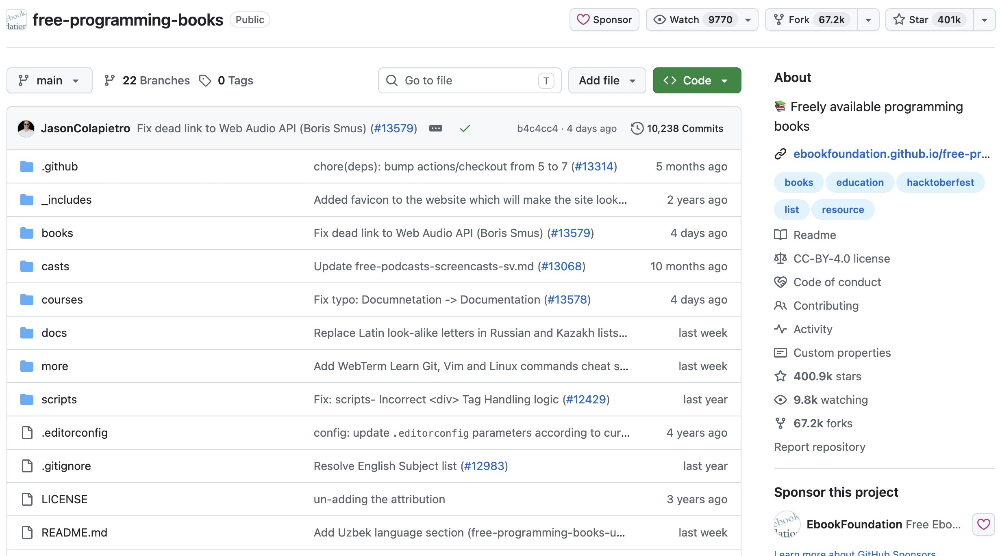

- [HowToCook](https://github.com/Anduin2017/HowToCook): A programmer's guide to cooking at home, with clear, step-by-step recipes.

    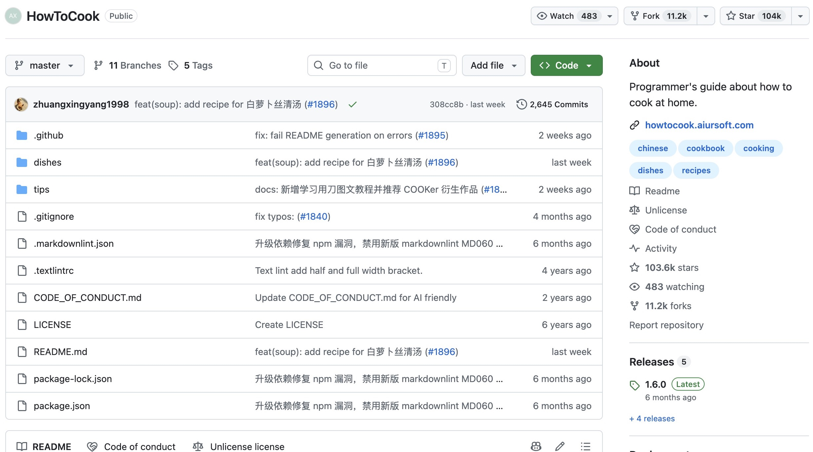

    

- [No Code](https://github.com/kelseyhightower/nocode): A humorous project about writing no code and deploying nowhere. This popular "empty repository" still contains a README and other files.

    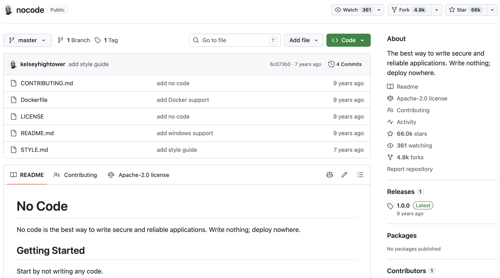

- [科技爱好者周刊 (Tech Enthusiast Weekly)](https://github.com/ruanyf/weekly): A weekly technology newsletter that welcomes reader submissions through Issues.

    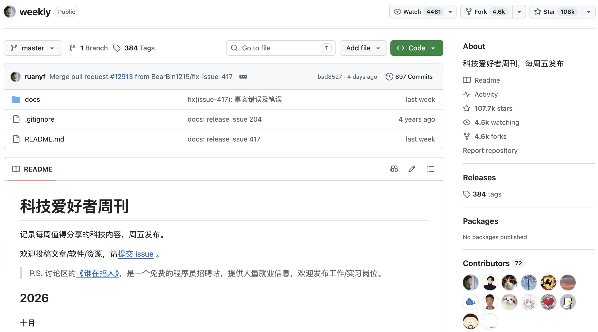

- [OSSU Computer Science](https://github.com/ossu/computer-science): A community-organized curriculum for teaching yourself computer science.

    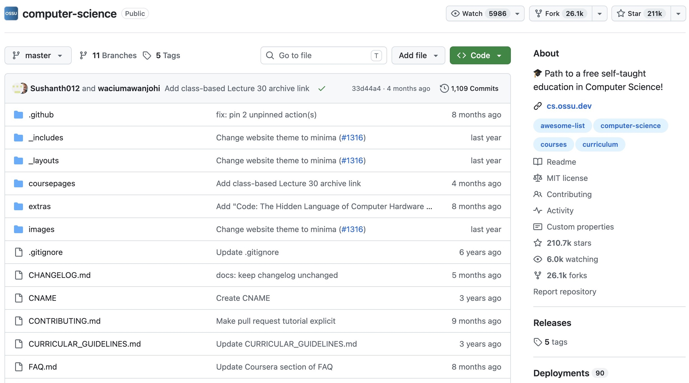


In addition to hosting code, GitHub also provides features such as **Issues (issue tracking), Actions (automation), Pages (static website hosting), Wiki (documentation), and Codespaces (cloud development environments)**. It has evolved into a complete developer community and engineering collaboration ecosystem.


### 2. What Is an Open-Source Platform? 

An **open-source platform** is a data hosting platform where source code is made public. It typically hosts a variety of open-source projects.

Open-source platforms usually use licenses to prevent the misuse of open-source content.

Well-known (or useful) open-source platforms:

- [GitHub](https://github.com/trending)
  ```Currently the world's largest open-source community platform with the strongest ecosystem```

    

- [Gitee](https://gitee.com/explore)
  ```A viable domestic alternative to GitHub in China```

    

- [Hugging Face](https://huggingface.co/models)
  ```An open-source platform for AI models```

    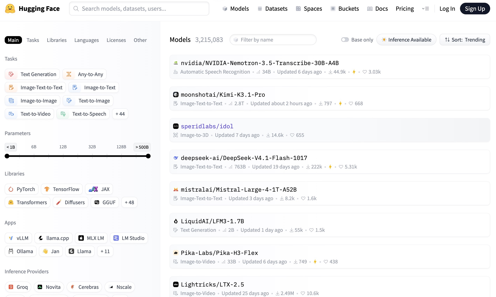

### 3. What Open-Source Platforms Are Available, and What Are GitHub's Advantages? 

Common code hosting / open-source platforms:

| Platform | Features |
| --- | --- |
| **GitHub** | The world's largest and most active community, with the most comprehensive ecosystem |
| **GitLab** | Offers self-hosting (deploying it yourself) and strong integrated DevOps capabilities |
| **Bitbucket** | Developed by Atlassian and integrates well with Jira and other tools |
| **Gitee** | A Chinese platform with fast access and a Chinese-language community |
| **SourceForge** | A long-established open-source project hosting platform |
| **GitCode** | A relatively new code hosting platform in China |

**GitHub's core advantages:**

1. **The largest community**: Nearly all well-known open-source projects (such as Linux-related resources, VS Code, React, Vue, and TensorFlow) are hosted on GitHub, where developers, organizations, and companies are highly concentrated.
2. **"Social Coding"**: Features such as Stars, Forks, Follows, and PRs make both code and developers discoverable and open to collaboration.
3. **The richest ecosystem**: GitHub Actions (automation), GitHub Pages (free website hosting), GitHub Copilot (an AI coding assistant), Codespaces, and other supporting services are all readily available.
4. **Generous free tier**: A free personal account can create unlimited public repositories (private repositories also have usage limits), which is sufficient for personal learning and small teams.
5. **The de facto standard**: The combination of `git` and GitHub has effectively become an industry-standard workflow. Job hunting, contributing to open source, and reading high-quality source code often begin with GitHub.

### 4. Practice: Register a GitHub Account 

Goal: Have your own GitHub account and be able to sign in and create repositories.

**Steps:**

1. Open a browser and visit **https://github.com**.
2. Click **Sign up** in the upper-right corner.
3. Follow the prompts and enter:
   - **Email**: Use an email address that you check regularly and can keep using long-term;
   - **Password**: Use at least 8 characters; a combination of uppercase and lowercase letters, numbers, and symbols is recommended;
   - **Username**: This will appear in your profile URL, `https://github.com/<username>`. Choose a short, recognizable, and professional name, such as the pinyin spelling of your name or a commonly used nickname;
4. Click **Create account**. GitHub will send a verification email to the address you provided.
5. Open your email and click **Verify email address** to complete verification.
6. Return to GitHub to access your profile page.

**Recommendations after registration:**

- Configure SSH to make it easier to clone GitHub repositories with git


---

## Section Two: Searching on GitHub (How to Find Useful Repositories)

!!! warn
    The search bar is at the top; the largest input box is not the search bar.

!!! tip
    So what is that largest input box? It is actually Copilot AI, where you can use a variety of advanced models (provided, of course, that you pay).

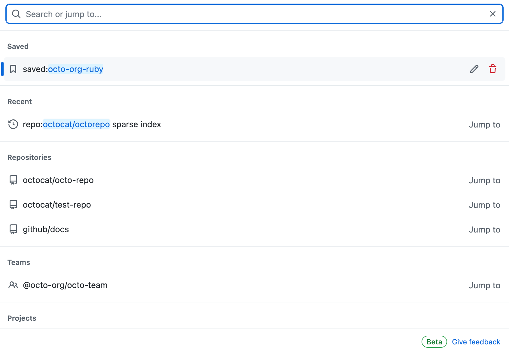

*Official GitHub Docs screenshots below illustrate the interface; dates, counts, and layout may differ from the current site.*

### 5. How to Evaluate a Repository 

When you encounter an unfamiliar repository, you can quickly assess whether it is worth using, learning from, or contributing to based on the following dimensions:

| Dimension | Where to Look | Description |
| --- | --- | --- |
| **Stars** | ⭐ in the upper-right corner of the repository page | Similar to favorites/likes and the most visible indicator of popularity; generally, more is better |
| **Forks** | Next to Stars | The number of times the repository has been copied for further development, indicating how many people have built upon it |
| **Watchers** | Repository page | The number of people following the repository, indicating sustained interest |
| **Issues** | Issues tab | Check the number of issues and whether maintainers respond to and resolve them promptly |
| **Latest commit time** | File list / Commits | Indicates whether the project is still being maintained |
| **Number of contributors** | Insights → Contributors | More contributors generally indicate healthier collaboration |
| **License** | Repository root / About section on the right | Determines whether and how you may use the code |
| **README quality** | Repository home page | Check whether it provides clear introductions, installation instructions, and usage guidance |
| **Releases / Tags** | Releases tab | Check whether stable versions exist and how frequently new versions are released |


### 6. How to Determine a Repository's Current Status 

"Status" mainly refers to whether a project is currently **active, maintained, or abandoned**. You can determine this by:

Reviewing the content under Insights

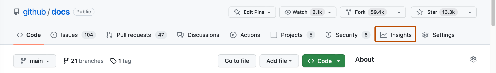

<br></br>1. **Pulse: Check whether the repository has been maintained recently**

   Pulse summarizes recent Pull Requests, Issues, and commit activity in the repository. If people are still regularly submitting code and handling issues, the project is usually still actively maintained.

<br></br>2. **Check Contributors**

   The Contributors page shows the number of participants and their contribution trends. If there are many contributors and people are still contributing recently, the project's collaboration and maintenance are relatively healthy.

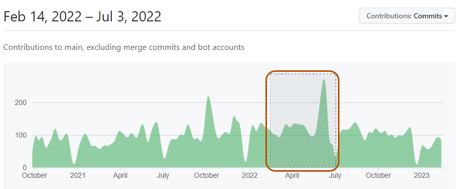

<br></br>3. **Check commits**

   Review the date of the most recent commit and the commit frequency to determine whether the code is still being updated. A long period without new commits may mean that the project is stable, or it may mean that maintenance has stopped; check Issues and Releases as well.

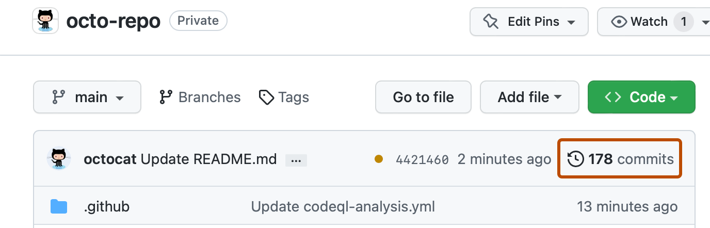

<br></br>4. **Check Network**

   The Network graph shows commit relationships and branch changes between the repository and its forks. If the original repository has stopped updating but one of its forks remains actively developed, you can follow that fork instead.

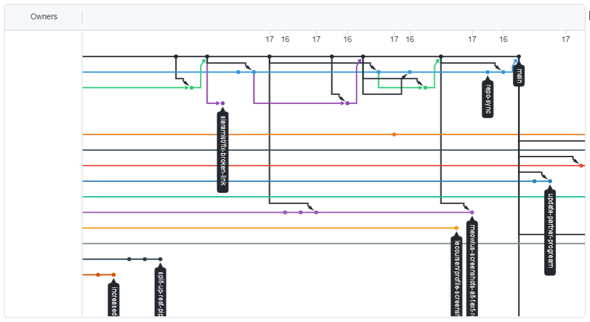

### 7. How to Download a Repository's Source Code 

There are several common methods. Choose one based on your needs:

**Method 1: Download a ZIP file directly (the simplest option, suitable if you only want to view the code)**

!!! tip
    This is suitable when you only want to use a repository's functionality without looking into its source code.

1. Open the repository page and click the green **Code** button.
2. Select **Download ZIP** from the drop-down menu.
3. Extract the archive to obtain the complete source code from the repository's current default branch.

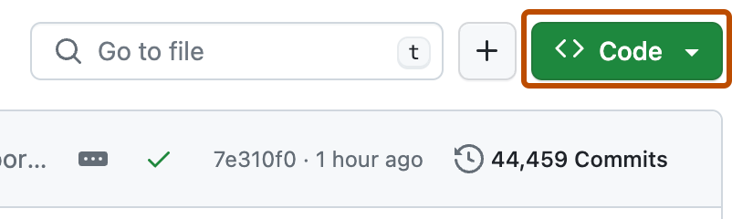

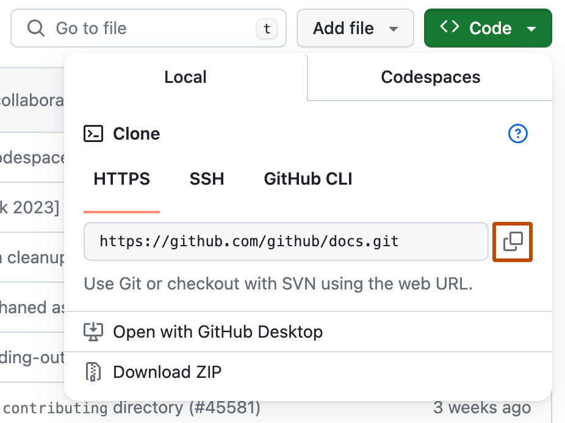

> Disadvantage: It does not include Git history and cannot pull future updates, so it is suitable for obtaining the code only once.

**Method 2: git clone (recommended if you want to use or further develop the code)**

After installing Git on your computer, open a terminal and run:

```bash
git clone https://github.com/<username>/<repository-name>.git
```

For example, clone a repository commonly used as an example in this project:

```bash
git clone https://github.com/github/gitignore.git
```

After cloning, you will have the complete repository and its version history locally. You can later use `git pull` to retrieve updates from the remote repository.

- **HTTPS** (`https://github.com/...`): Easy to configure and broadly compatible; recommended for beginners.
- **SSH** (`git@github.com:...`): Requires configuring an SSH key first. It is faster and suitable for frequent pushes, but the setup is slightly more complex.

**Method 3: Download a Release (suitable for software that can be run directly)**

If you only want an executable file or installer for a piece of software, do not download the source code. Instead, open the **Releases** page and download the release package for your platform (Windows / macOS / Linux), such as an `.exe`, `.dmg`, or `.zip` file.

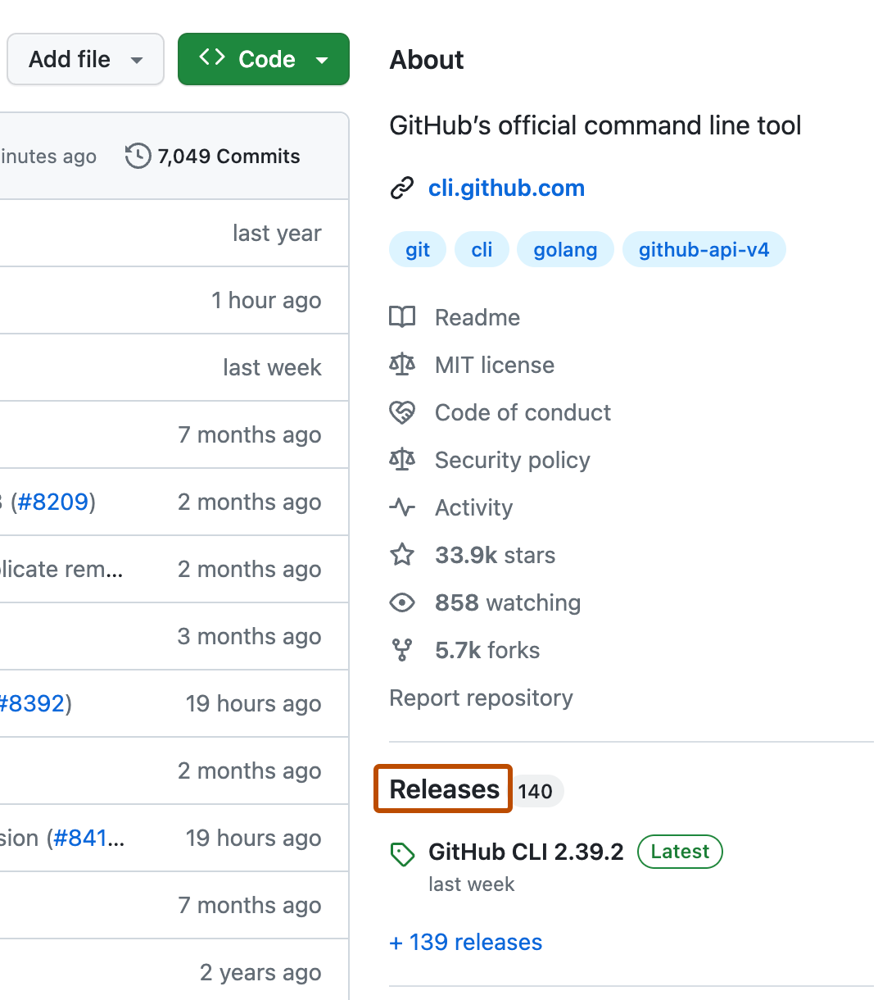

### 8. Some Useful Repositories 

The following public repositories are very useful for learning and getting started. Search for and explore them according to your interests:

**Learning**

- **free-programming-books-zh**: A collection of free Chinese programming books.
- **freeCodeCamp/freeCodeCamp**: An open-source platform offering free programming courses and exercises.
- **TheAlgorithms**: A collection of data structures and algorithms implemented in various programming languages.

**Resource Collections (Awesome Lists)**

- **awesome**: A central collection of curated resource lists covering a wide variety of topics.
- **awesome-chinese** / various `awesome-xxx` repositories: Curated resource lists organized by topic, making it easy to follow a trail of useful resources.

**Engineering / Tools**

- **github/gitignore**: A collection of `.gitignore` templates for various languages and environments.
- **vscode**: The source code of Microsoft's open-source editor, VS Code; suitable for studying a large-scale project.
- **vuejs/vue** and **facebook/react**: The source code of mainstream front-end frameworks.

**Practice (based on this section):**

1. Search for a topic that interests you
2. Find a well-maintained repository
3. Download some useful code


*Additional screenshots: [GitHub Docs](https://docs.github.com), used under [CC BY 4.0](https://creativecommons.org/licenses/by/4.0/). [Image sources](../../assets/images/part1-image-sources.md).*
