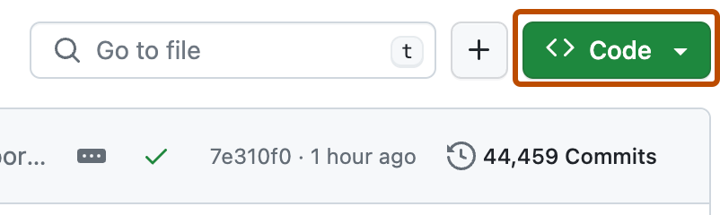
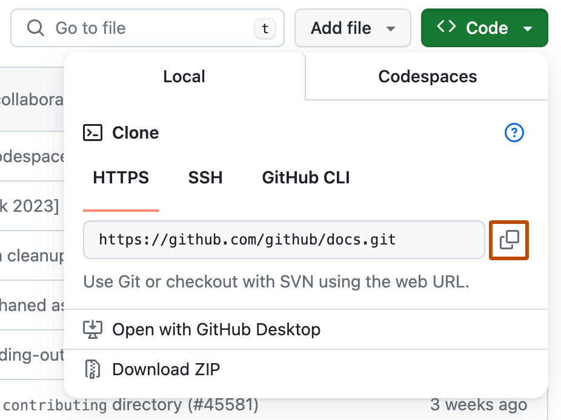
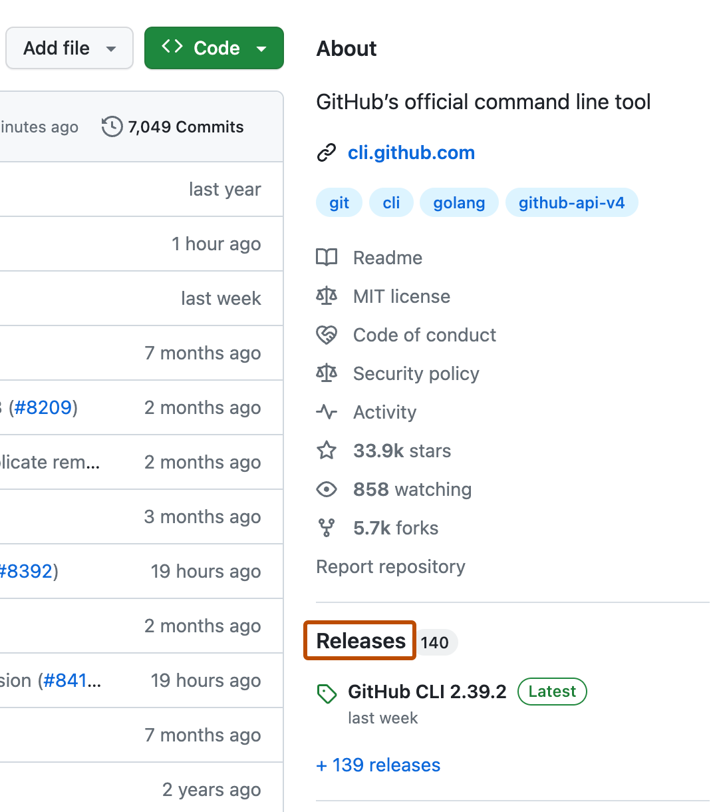

# How to Download a Repository's Source Code

There are several common methods. Choose one based on your needs:

*Official GitHub Docs screenshots below illustrate the interface; dates, counts, and layout may differ from the current site.*

**Method 1: Download a ZIP file directly (the simplest option, suitable if you only want to view the code)**

!!! tip
    This is suitable when you only want to use a repository's functionality without looking into its source code.

1. Open the repository page and click the green **Code** button.
2. Select **Download ZIP** from the drop-down menu.
3. Extract the archive to obtain the complete source code from the repository's current default branch.



> Disadvantage: It does not include Git history and cannot pull future updates, so it is suitable for obtaining the code only once.

**Method 2: git clone (recommended if you want to use or further develop the code)**



The drop-down menu also lets you switch branch or tag first — handy when the version you want is not the default branch.

After installing Git on your computer, open a terminal and run:

```bash
git clone https://github.com/<username>/<repository-name>.git
```

For example, clone a repository commonly used as an example in this project:

```bash
git clone https://github.com/github/gitignore.git
```

After cloning, you will have the complete repository and its version history locally. You can later use `git pull` to retrieve updates from the remote repository.

- **HTTPS** (`https://github.com/...`): Easy to configure and broadly compatible; recommended for beginners.
- **SSH** (`git@github.com:...`): Requires configuring an SSH key first. It is faster and suitable for frequent pushes, but the setup is slightly more complex.

!!! tip "Clone only the latest snapshot"
    Some repositories have years of history and take a long time to download. `git clone --depth 1` downloads only the latest version, which is much faster if you don't need the full history.

**Method 3: Download a Release (suitable for software that can be run directly)**

If you only want an executable file or installer for a piece of software, do not download the source code. Instead, open the **Releases** page and download the release package for your platform (Windows / macOS / Linux), such as an `.exe`, `.dmg`, or `.zip` file.



Release pages usually come with release notes describing what changed — read them to decide whether to upgrade.
