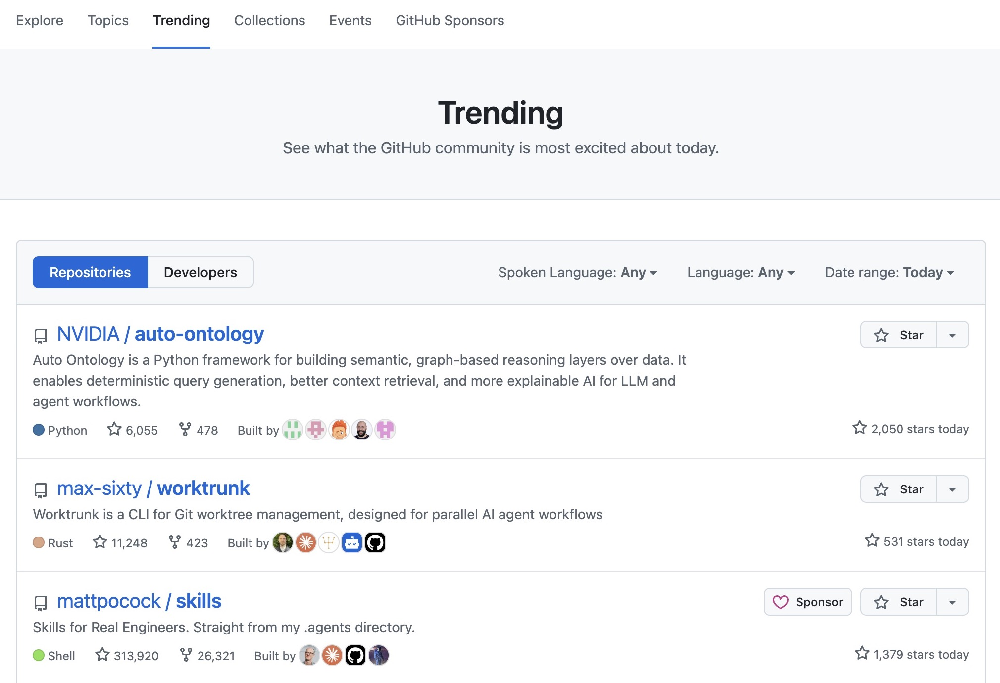
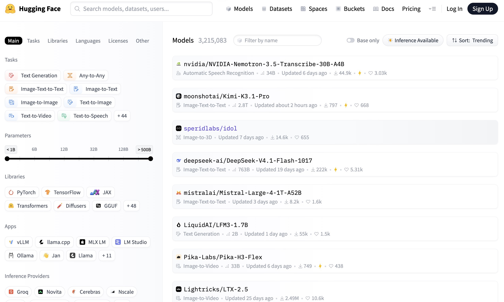

# What Is an Open-Source Platform?

An **open-source platform** is a data hosting platform where source code is made public. It typically hosts a variety of open-source projects.

Open-source platforms usually use licenses to prevent the misuse of open-source content.

Why does open source matter? Because the code is public, anyone can **learn from it, reuse it, fix it, and build on it** — the software world we use every day is largely built this way. If you want to know how licenses work, see [Choose a license](../repo-management/license.md) in the next part.

Open source is everywhere: the **Linux** kernel, the **Android** system, the **Chromium** browser, **Python** itself, and the **LLaMA** models are all open source — reading their code on platforms like GitHub is one of the best ways to learn programming.

## Well-known (or useful) open-source platforms

- [GitHub](https://github.com/trending) — the world's largest open-source community platform with the strongest ecosystem.

    

- [Gitee](https://gitee.com/explore) — a viable domestic alternative to GitHub in China.

    

- [Hugging Face](https://huggingface.co/models) — an open-source platform for AI models.

    

## What platforms are available, and what are GitHub's advantages?

Common code hosting / open-source platforms:

| Platform | Features |
| --- | --- |
| **GitHub** | The world's largest and most active community, with the most comprehensive ecosystem |
| **GitLab** | Offers self-hosting (deploying it yourself) and strong integrated DevOps capabilities |
| **Bitbucket** | Developed by Atlassian and integrates well with Jira and other tools |
| **Gitee** | A Chinese platform with fast access and a Chinese-language community |
| **SourceForge** | A long-established open-source project hosting platform |
| **GitCode** | A relatively new code hosting platform in China |

**GitHub's core advantages:**

1. **The largest community**: Nearly all well-known open-source projects (such as Linux-related resources, VS Code, React, Vue, and TensorFlow) are hosted on GitHub, where developers, organizations, and companies are highly concentrated.
2. **"Social Coding"**: Features such as Stars, Forks, Follows, and PRs make both code and developers discoverable and open to collaboration.
3. **The richest ecosystem**: GitHub Actions (automation), GitHub Pages (free website hosting), GitHub Copilot (an AI coding assistant), Codespaces, and other supporting services are all readily available.
4. **Generous free tier**: A free personal account can create unlimited public repositories (private repositories also have usage limits), which is sufficient for personal learning and small teams.
5. **The de facto standard**: The combination of `git` and GitHub has effectively become an industry-standard workflow. Job hunting, contributing to open source, and reading high-quality source code often begin with GitHub.
