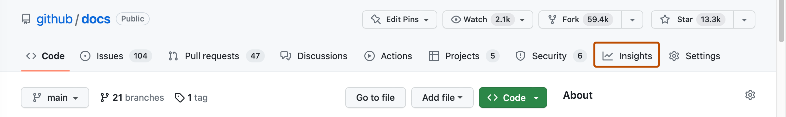
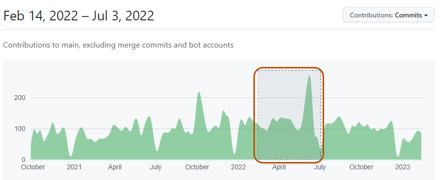
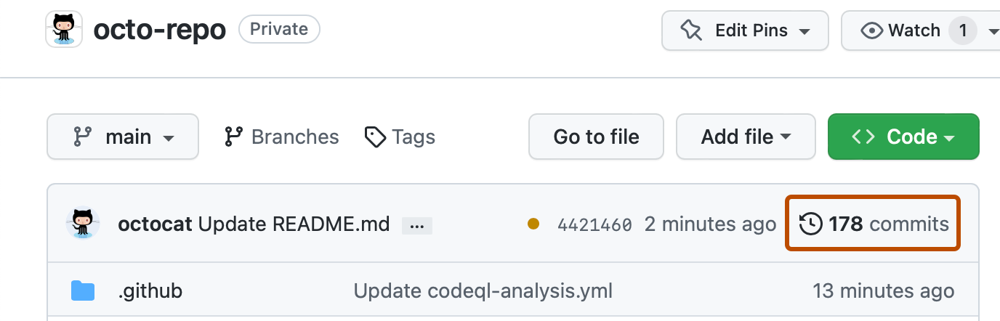
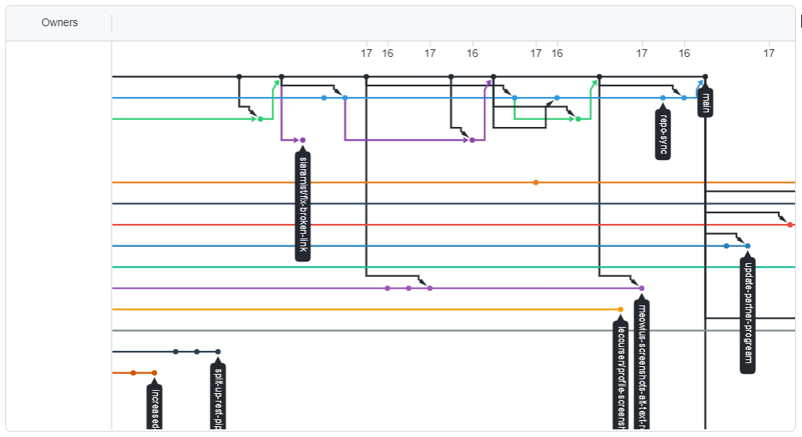

# How to Determine a Repository's Current Status

"Status" mainly refers to whether a project is currently **active, maintained, or abandoned**. You can determine this by reviewing the content under **Insights**:

*Official GitHub Docs screenshots below illustrate the interface; dates, counts, and layout may differ from the current site.*

1. **Pulse: Check whether the repository has been maintained recently**

   Pulse summarizes recent Pull Requests, Issues, and commit activity in the repository. If people are still regularly submitting code and handling issues, the project is usually still actively maintained.

2. **Check Contributors**

   The Contributors page shows the number of participants and their contribution trends. If there are many contributors and people are still contributing recently, the project's collaboration and maintenance are relatively healthy.

   

3. **Check commits**

   Review the date of the most recent commit and the commit frequency to determine whether the code is still being updated. A long period without new commits may mean that the project is stable, or it may mean that maintenance has stopped; check Issues and Releases as well.

   

4. **Check Network**

   The Network graph shows commit relationships and branch changes between the repository and its forks. If the original repository has stopped updating but one of its forks remains actively developed, you can follow that fork instead.

   

5. **Check Community standards**

   The Community page shows whether the project provides a contributing guide, a code of conduct, and issue/PR templates. Healthy projects usually take these seriously — it also means they welcome new contributors.

!!! note "One more sign: the Archived badge"
    If a repository is **archived**, GitHub shows an "Archived" banner and makes it **read-only**: you can still read and fork the code, but no one can push commits or open issues. An archived repository is officially no longer maintained.

**Practice:** pick a repository you are interested in and use the methods above to judge whether it is still actively maintained — and briefly explain why.
