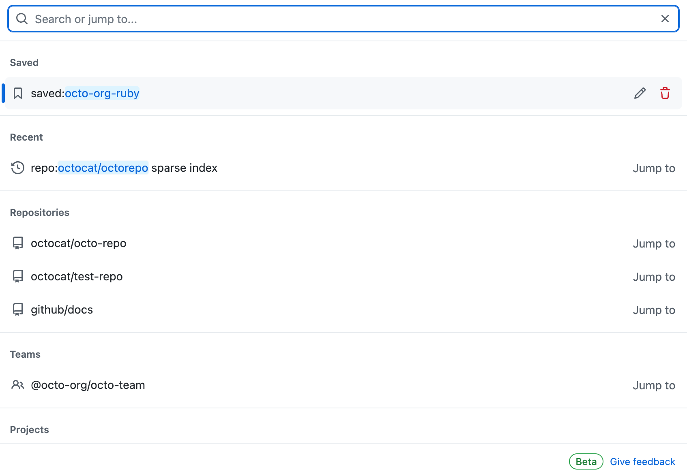

# Searching on GitHub

!!! warning
    The search bar is at the top; the largest input box is not the search bar.

!!! tip
    So what is that largest input box? It is actually GitHub Copilot, where you can use a variety of advanced models (provided, of course, that you pay).

*Official GitHub Docs screenshots below illustrate the interface; dates, counts, and layout may differ from the current site.*

!!! tip "Narrow down results with search qualifiers"
    You can also search with qualifiers, for example `stars:>1000 language:python topic:machine-learning` returns popular Python repositories about machine learning. GitHub offers many such qualifiers — type your keyword first, then use the sidebar filters or the autocomplete suggestions.

Common qualifiers:

| Qualifier | Example | Meaning |
| --- | --- | --- |
| `stars:` | `stars:>1000` | Repositories with more than 1000 stars |
| `language:` | `language:python` | Repositories written in the given language |
| `topic:` | `topic:machine-learning` | Repositories tagged with the given topic |
| `user:` | `user:torvalds` | Repositories owned by the given user |
| `org:` | `org:github` | Repositories owned by the given organization |
| `repo:` | `repo:torvalds/linux` | Restrict the search to the given repository |
| `pushed:` | `pushed:>2026-01-01` | Repositories pushed to recently (still alive?) |

!!! note
    Two more things to know: **code search requires signing in** to GitHub, and results can be sorted by *Best match*, *Most stars*, or *Recently updated* using the sort menu above the result list.

## How to evaluate a repository

When you encounter an unfamiliar repository, you can quickly assess whether it is worth using, learning from, or contributing to based on the following dimensions:

| Dimension | Where to Look | Description |
| --- | --- | --- |
| **Stars** | ⭐ in the upper-right corner of the repository page | Similar to favorites/likes and the most visible indicator of popularity; generally, more is better |
| **Forks** | Next to Stars | The number of times the repository has been copied for further development, indicating how many people have built upon it |
| **Watchers** | Repository page | The number of people following the repository, indicating sustained interest |
| **Issues** | Issues tab | Check the number of issues and whether maintainers respond to and resolve them promptly; see [Report problems with issues](../repo-management/issues.md) |
| **Latest commit time** | File list / Commits | Indicates whether the project is still being maintained |
| **Number of contributors** | Insights → Contributors | More contributors generally indicate healthier collaboration |
| **License** | Repository root / About section on the right | Determines whether and how you may use the code |
| **README quality** | Repository home page | Check whether it provides clear introductions, installation instructions, and usage guidance |
| **Releases / Tags** | Releases tab | Check whether stable versions exist and how frequently new versions are released |
