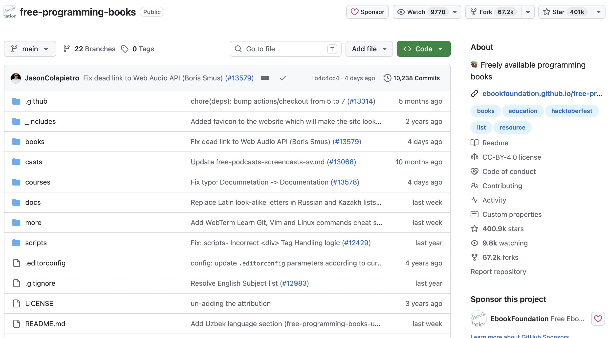
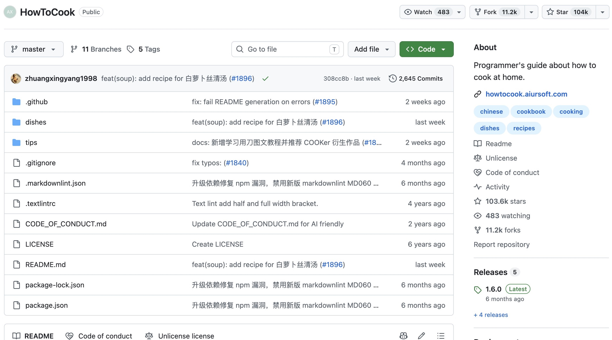
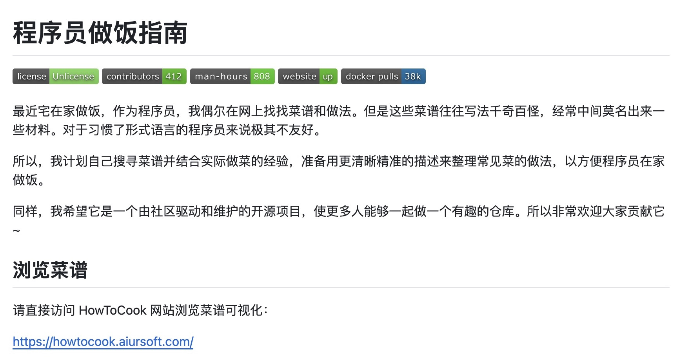
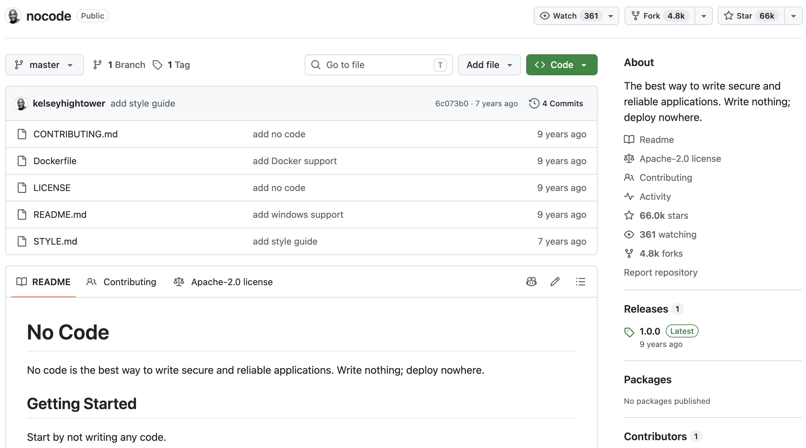
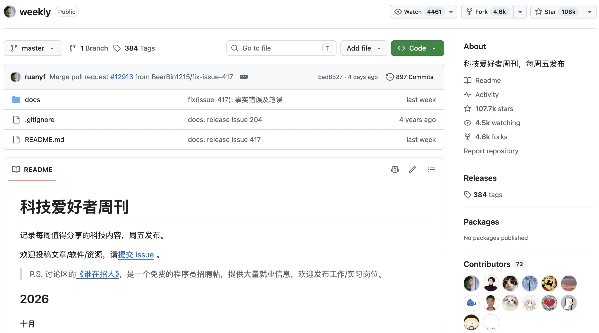
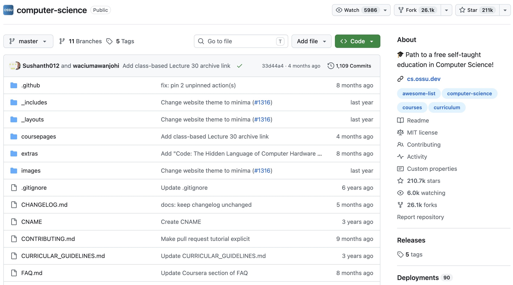

# What Is GitHub?

GitHub is a code hosting and collaboration platform built on the **Git** version control system. It launched in 2008 and was acquired by Microsoft in 2018. Simply put, it is a website for "storing code and writing code with others."

Today it has more than 100 million registered developers, and most of the open-source projects you will meet in your courses are hosted here.

!!! tip
    GitHub is different from Git. GitHub is an open-source platform whose repositories are based on Git. You can also find unexpected things on GitHub, even if they have nothing to do with coding.
    In theory, you can upload anything you want to share.

## Git, the engine behind GitHub

Git is a **distributed version control system** created by Linus Torvalds in 2005. It runs on your own computer and records every change you make to your files. Thanks to Git, you can:

- go back to any previous version at any time (no more `homework_final_v2_really_final.zip`);
- work in parallel with others through **branches**, and merge your work back together.

A few terms you will meet again and again:

| Term | Meaning |
| --- | --- |
| **Repository (仓库)** | The place where a project's files and history live |
| **Commit (提交)** | A snapshot of your changes, like a save point in a game |
| **Branch (分支)** | A parallel line of development; the default branch is usually called `main` |
| **Remote (远端)** | A copy of the repository hosted on a server, such as GitHub |

GitHub builds on Git: it hosts the remote repositories, and adds the web interface and the community features you will see throughout this workshop.

## Some interesting examples

- [Free Programming Books](https://github.com/EbookFoundation/free-programming-books): A community-maintained collection of free programming books and learning resources.

    

- [HowToCook](https://github.com/Anduin2017/HowToCook): A programmer's guide to cooking at home, with clear, step-by-step recipes.

    

    

- [No Code](https://github.com/kelseyhightower/nocode): A humorous project about writing no code and deploying nowhere. This popular "empty repository" still contains a README and other files.

    

- [科技爱好者周刊 (Tech Enthusiast Weekly)](https://github.com/ruanyf/weekly): A weekly technology newsletter that welcomes reader submissions through Issues.

    

- [OSSU Computer Science](https://github.com/ossu/computer-science): A community-organized curriculum for teaching yourself computer science.

    

## Beyond code hosting

In addition to hosting code, GitHub also provides features such as **Issues (issue tracking), Actions (automation), Pages (static website hosting), Wiki (documentation), and Codespaces (cloud development environments)**. It has evolved into a complete developer community and engineering collaboration ecosystem.
