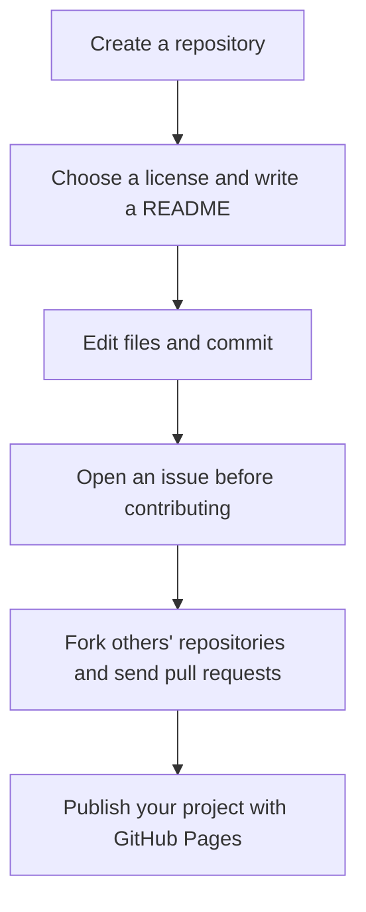

# Using a GitHub Repository

> **Author:** Zhang Junming

In [the first part](../github-introduction/index.md), you learned what GitHub is and how to find, evaluate, and download repositories. Now it is time to create your own repository and maintain it, and to experience the complete open-source collaboration workflow.

Before you start, make sure you have:

- a GitHub account (see [Register a GitHub account](../github-introduction/register-account.md));
- Git installed on your computer, and a terminal you are comfortable with.

## The overall workflow

In a nutshell:

**First [create a repository](create-repository.md) → use [a license](license.md) and [a README](readme.md) to clarify the project → [open an issue](issues.md) before contributing → [fork](fork.md) and follow the [pull request](contribute.md) flow → use [web editing](edit-online.md) for small daily changes → once the project matures, [publish a web page](github-pages.md) for display.**

## By the end of this part

You will have:

- a repository of your own, with a license and a README;
- your own web page published with GitHub Pages;
- a fork of someone else's repository (and maybe a pull request to it);
- a well-written issue you have opened.

## Chapters

- [Create a repository](create-repository.md): create your first repository and put code into it.
- [Choose a license](license.md): decide how others may use your code.
- [Report problems with issues](issues.md): the built-in ticket system of a repository, and the first step of contributing.
- [Fork a repository](fork.md): copy someone else's repository to your own account.
- [Contribute with a pull request](contribute.md): the core flow of open-source collaboration.
- [Edit files on the web](edit-online.md): make quick changes without local Git.
- [Write a README](readme.md): the "first business card" of your project.
- [Publish with GitHub Pages](github-pages.md): turn your repository into a free website.
