走近 GitHub

---

## 第一部分：引入——走近 GitHub


这是 GitHub 的标志

### 1. GitHub 是什么

GitHub 是一个基于 **Git** 版本控制系统构建的代码托管与协作平台，于 2008 年上线，2018 年被微软收购。简单来说，它是一个"存放代码、和别人一起写代码"的网站。

!!! tip
    GitHub 与 Git 不同。GitHub 是一个开源平台，其仓库基于 Git。不过，你能在GitHub上找到一些意想不到的内容，即使它们与编程毫无关系。
    理论上，你可以放上任何你想分享的内容。

**一些有趣的例子**

- [Free Programming Books](https://github.com/EbookFoundation/free-programming-books)：由社区维护的免费编程书籍和学习资源合集。

    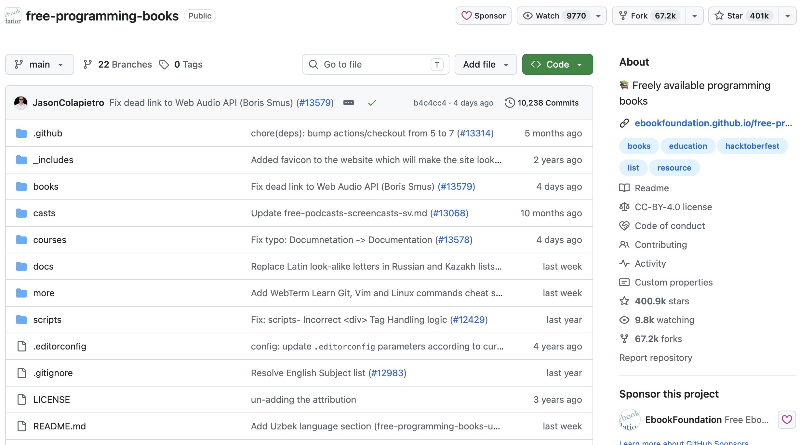

- [HowToCook](https://github.com/Anduin2017/HowToCook)：程序员的居家做饭指南，提供清晰、分步骤的菜谱。

    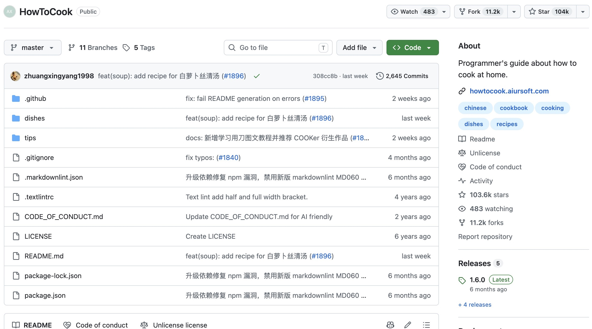

    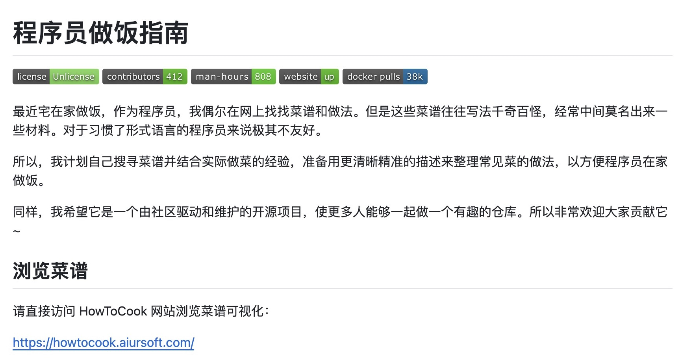

- [No Code](https://github.com/kelseyhightower/nocode)：一个以“不写代码，也不部署到任何地方”为主题的幽默项目。这个受欢迎的“空仓库”仍然包含 README 和其他文件。

    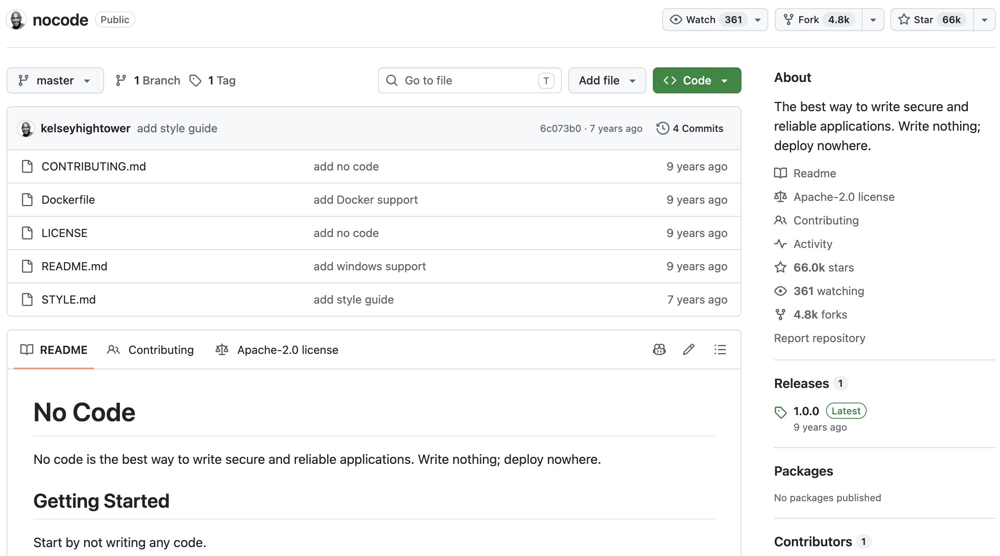

- [科技爱好者周刊](https://github.com/ruanyf/weekly)：每周发布的科技资讯周刊，欢迎读者通过 Issues 投稿。

    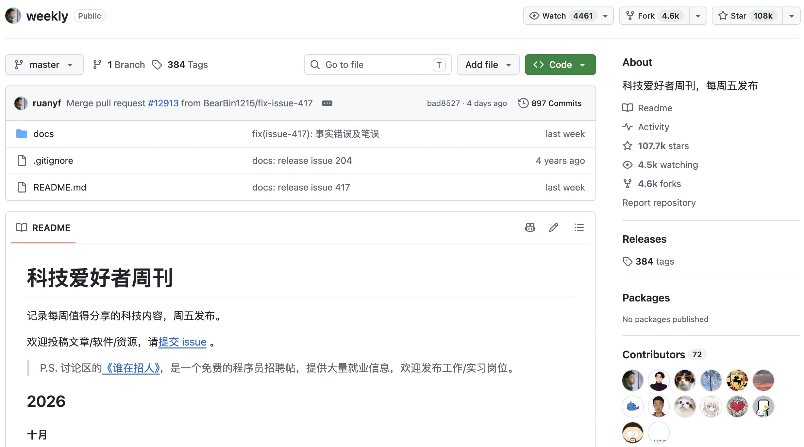

- [OSSU Computer Science](https://github.com/ossu/computer-science)：由社区组织的计算机科学自学课程体系。

    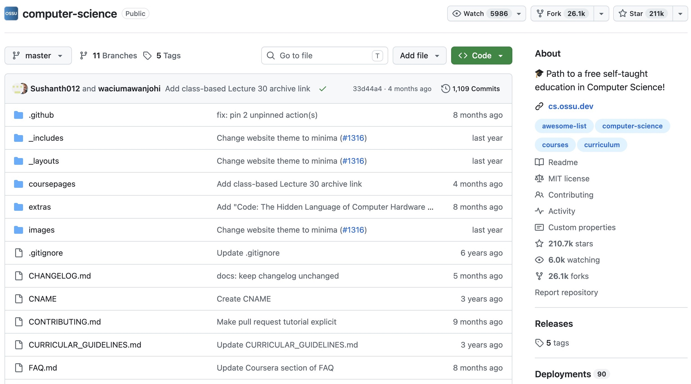

除了托管代码，GitHub 还提供 **Issue（问题追踪）、Actions（自动化）、Pages（静态网站托管）、Wiki（文档）、Codespaces（云端开发环境）** 等功能，已经发展成一个完整的开发者社区和工程协作生态。


### 2. 什么是开源平台

**开源平台**，即是公开源代码的数据托管平台，通常承载了各种不同的开源项目。

开源平台通常会设置许可证，避免开源内容滥用。

经典（或者有用）的开源平台：

- [GitHub](https://github.com/trending)
  ```目前世界上最大也是生态最好的开源社区平台```

    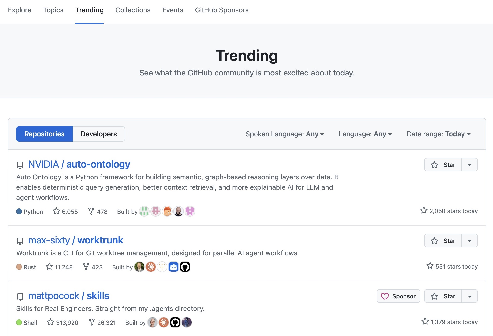

- [Gitee](https://gitee.com/explore)
  ```国内一个可行的 GitHub 替代平台```

    

- [Hugging Face](https://huggingface.co/models)
  ```AI 模型的开源平台```

    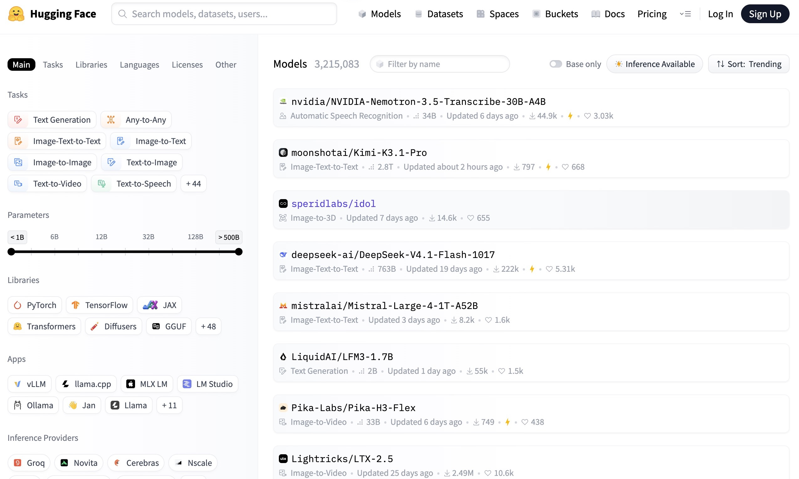

### 3. 开源平台有哪些，GitHub 在其中的优势是什么

常见的代码托管 / 开源平台：

| 平台 | 特点 |
| --- | --- |
| **GitHub** | 全球最大、社区最活跃，生态最完善 |
| **GitLab** | 提供自托管（自己部署）方案，DevOps 一体化能力强 |
| **Bitbucket** | 由 Atlassian 出品，与 Jira 等工具集成好 |
| **Gitee（码云）** | 国内平台，访问速度快，中文社区 |
| **SourceForge** | 老牌开源项目托管站 |
| **GitCode** | 国内较新的开源托管平台 |

**GitHub 的核心优势：**

1. **社区规模最大**：几乎所有知名开源项目（如 Linux 相关资料、VS Code、React、Vue、TensorFlow 等）都托管在 GitHub 上，开发者、组织和公司高度聚集。
2. **"社交化编程"（Social Coding）**：通过 Star（收藏/点赞）、Fork（复刻）、Follow（关注）、PR 等方式，让代码和开发者都"可被发现、可被协作"。
3. **生态最丰富**：GitHub Actions（自动化）、GitHub Pages（免费网站托管）、GitHub Copilot（AI 编程助手）、Codespaces 等配套服务一应俱全。
4. **免费额度友好**：个人免费账号即可创建无限公开仓库（私有仓库也有限额），对个人学习和小型团队足够使用。
5. **事实上的标准**：`git` + GitHub 的用法几乎成为行业通行做法，找工作、参与开源、阅读优秀源码大多从 GitHub 开始。

### 4. 实践：注册 GitHub 账号

目标：拥有一个自己的 GitHub 账号，能登录、能创建仓库。

**步骤：**

1. 打开浏览器，访问 **https://github.com**。
2. 点击右上角 **Sign up**（注册）。
3. 按提示依次填写：
   - **邮箱**：建议用常用、可长期使用的邮箱；
   - **密码**：至少 8 位，建议包含大小写字母、数字和符号；
   - **用户名（Username）**：会出现在你的主页地址 `https://github.com/<用户名>` 中，建议用简短、易识别、专业的名字（如姓名拼音或常用昵称）；
4. 点击 **Create account**，GitHub 会向你填写的邮箱发送一封验证邮件。
5. 登录邮箱，点击邮件中的 **Verify email address** 完成验证。
6. 回到 GitHub，即可进入你的个人主页。

**完成注册后的建议：**

- 配置 SSH：便于使用 Git 克隆 GitHub 上的仓库


---

## 第二部分：GitHub 的搜索（怎么找到有用的仓库）

!!! warn
    搜索栏在上方，那个最大的输入框不是搜索栏

!!! tip
   那么这个最大的搜索栏是什么？实际上这是copilotAI，在这里你可以使用许多不同的先进模型（当然前提是你得充钱）

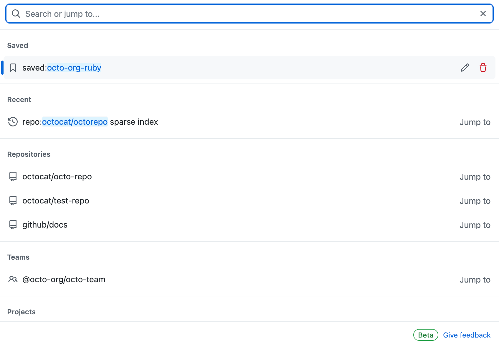

*下方 GitHub 官方文档截图用于展示界面；日期、数量和布局可能与当前网站有所不同。*

### 5. 怎么评价一个仓库

面对一个陌生仓库，可以从以下几个维度快速评估它"值不值得用 / 学 / 参与"：

| 维度 | 在哪里看 | 说明 |
| --- | --- | --- |
| **Star 数** | 仓库主页右上角 ⭐ | 相当于"收藏/点赞"数，是受欢迎程度最直观的指标，一般越多越好 |
| **Fork 数** | Star 旁边 | 被复刻的次数，反映有多少人基于它做二次开发 |
| **Watch 数** | 仓库主页 | 关注人数，反映持续关注度 |
| **Issue 情况** | Issues 标签页 | 看 issue 数量、是否有维护者及时回复和处理 |
| **最近提交时间** | 文件列表 / Commits | 判断项目是否还在维护 |
| **Contributor 数量** | Insights → Contributors | 参与人数越多，说明协作越健康 |
| **License** | 仓库根目录 / 右侧 About | 决定你能不能用、怎么用这份代码 |
| **README 质量** | 仓库首页 | 是否有清晰的介绍、安装和使用说明 |
| **Release / Tag** | Releases 标签页 | 是否有稳定版本号，是否频繁发版 |


### 6. 如何判断一个仓库现在的状态

"状态"主要指这个项目目前是**活跃、维护中，还是已经弃坑**。判断方法：

观察 Insights 中的内容

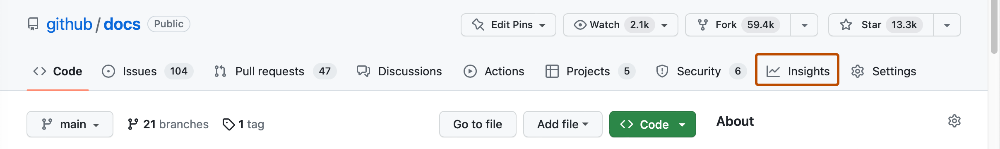

<br></br>1. **Pulse：检查这个仓库最近是否有人维护**

   Pulse 会汇总仓库近期的 Pull Request、Issue 和提交活动。若最近持续有人提交代码、处理问题，通常说明项目仍在活跃维护。

<br></br>2. **看 Contributors**

   Contributors 页面可以看到参与者数量及各自的贡献趋势。贡献者较多且近期仍有人持续贡献，说明项目的协作和维护相对健康。

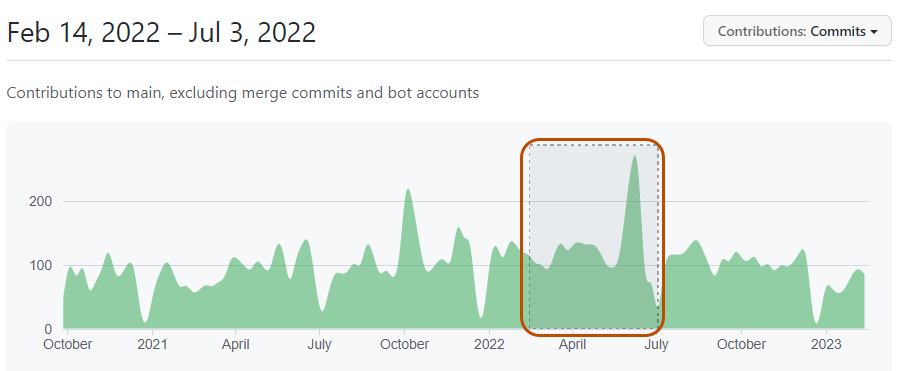

<br></br>3. **看 commits**

   查看最近一次提交时间以及提交频率，判断代码是否还在更新。长期没有新提交可能表示项目已稳定，也可能已经停止维护，需要结合 Issue 和 Release 一起判断。

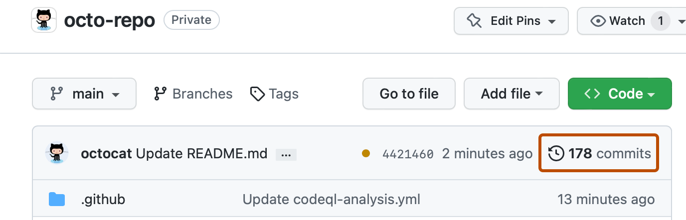

<br></br>4. **看 Network**

   Network 图展示仓库及其 Fork 之间的提交关系和分支变化。如果原仓库更新停滞，但某个 Fork 仍在活跃开发，可以进一步关注该 Fork。

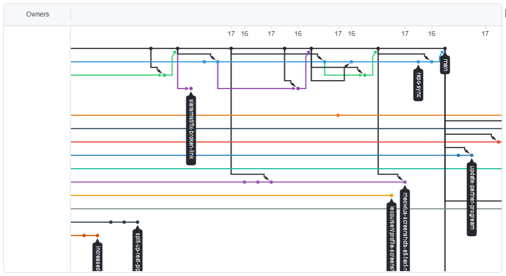

### 7. 怎么下载一个仓库的源代码

有几种常用方式，按场景选择：

**方式一：直接下载 ZIP（最简单，适合只想看代码）**

!!! tip
   这适用于你只想使用某个仓库的功能而不想知道它的源代码具体长什么样的时候

1. 进入仓库主页，点击绿色的 **Code** 按钮。
2. 在下拉菜单中选择 **Download ZIP**。
3. 解压后即可得到该仓库当前默认分支的完整源代码。

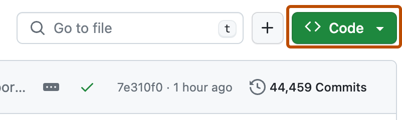

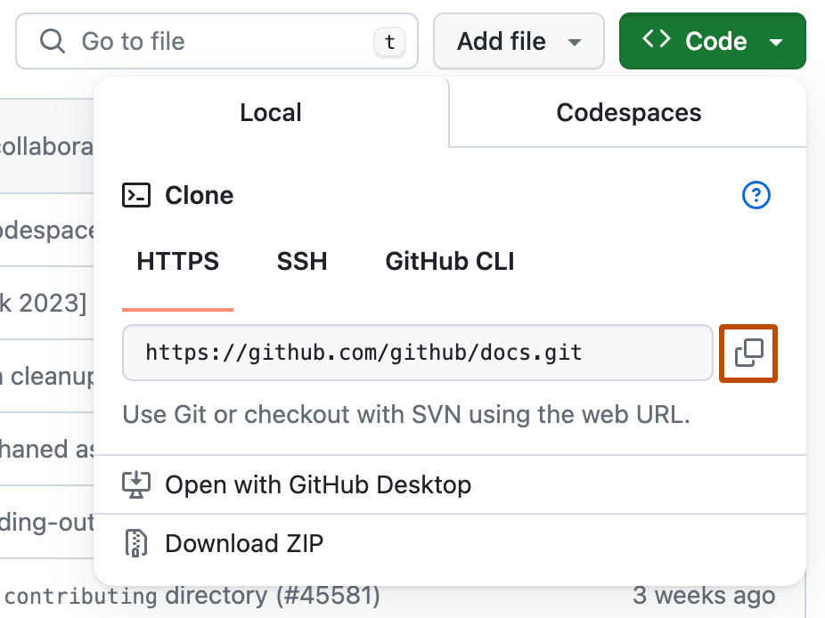

> 缺点：不含 Git 历史记录，也无法后续拉取更新，适合一次性获取代码。

**方式二：git clone（推荐，适合要使用/二次开发）**

在电脑上安装 Git 后，打开终端（Terminal），执行：

```bash
git clone https://github.com/<用户名>/<仓库名>.git
```

例如克隆本项目常用的示例：

```bash
git clone https://github.com/github/gitignore.git
```

克隆完成后，本地就拥有该仓库的完整内容与版本历史，之后可用 `git pull` 获取远端更新。

- **HTTPS 方式**（`https://github.com/...`）：配置简单，通用性最好，推荐初学者使用。
- **SSH 方式**（`git@github.com:...`）：需要先配置 SSH 密钥，速度更快、适合频繁推送，但配置稍复杂。

**方式三：下载 Release 发行版（适合下载可直接运行的软件）**

如果只是想下载某个软件的可执行文件或安装包，不要下载源码，而是进入 **Releases** 页面，下载对应平台（Windows / macOS / Linux）的 `.exe`、`.dmg`、`.zip` 等发行包。

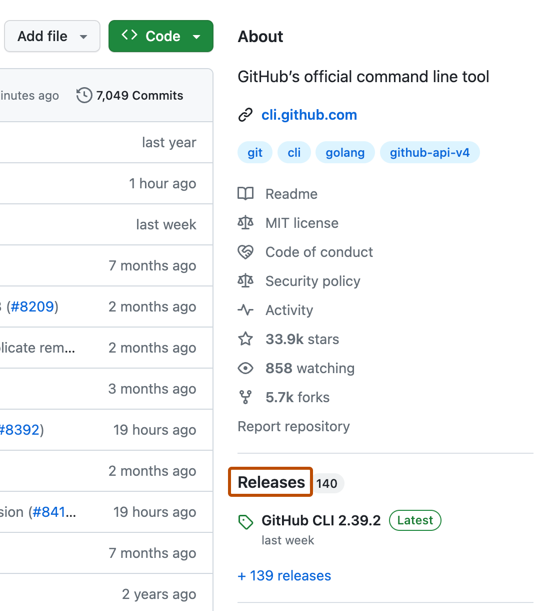

### 8. 一些有用的仓库

以下是一些对学习和入门非常有帮助的公开仓库，可按兴趣搜索并实践：

**学习类**

- **free-programming-books-zh**：免费的中文编程书籍合集。
- **freeCodeCamp/freeCodeCamp**：开源的免费编程学习课程与练习平台。
- **TheAlgorithms**：用各种语言实现的数据结构与算法合集。

**资源合集类（Awesome 系列）**

- **awesome**：各种主题的"精选资源清单"总入口。
- **awesome-chinese** / 各类 `awesome-xxx`：按主题整理的优质资源列表，非常适合按图索骥。

**工程/工具类**

- **github/gitignore**：各种语言和环境的 `.gitignore` 模板合集。
- **vscode**：微软的开源编辑器 VS Code 源码，适合阅读大型项目。
- **vuejs/vue**、**facebook/react**：主流前端框架源码。

**实践环节（结合本部分内容）：**

1. 搜索一个感兴趣的话题
2. 找到一个维护良好的仓库
3. 下载一些有用的代码


*其他截图：[GitHub Docs](https://docs.github.com)，依据 [CC BY 4.0](https://creativecommons.org/licenses/by/4.0/) 使用。[图片来源](../../assets/images/part1-image-sources.md)。*
