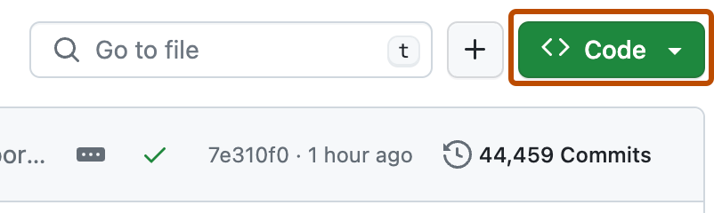
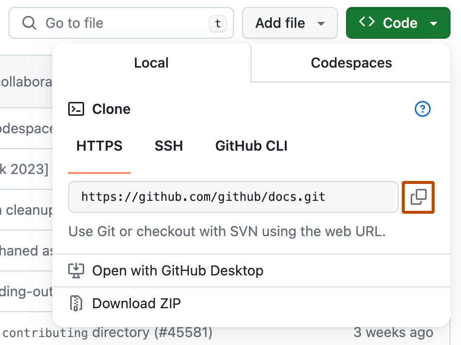
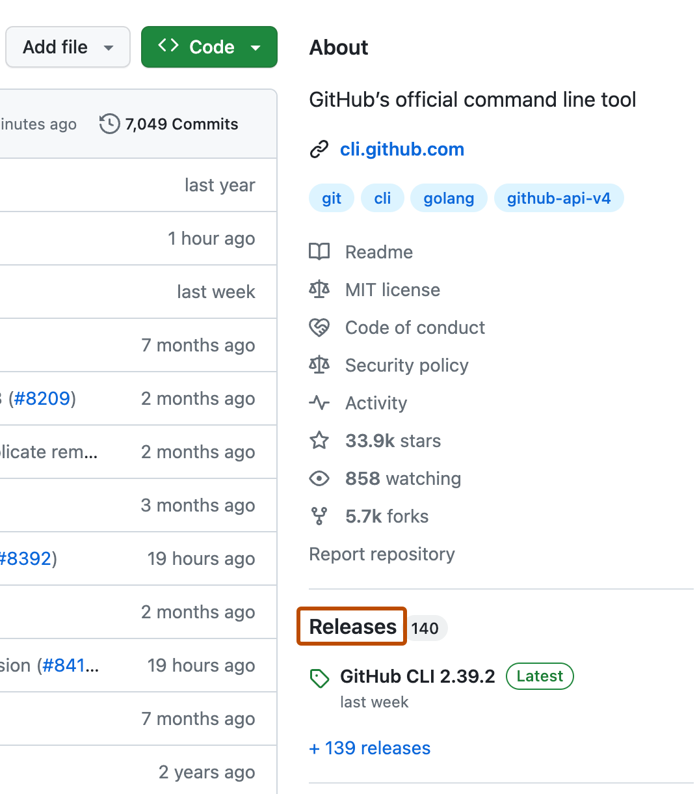

# 怎么下载一个仓库的源代码

有几种常用方式，按场景选择：

*下方 GitHub 官方文档截图用于展示界面；日期、数量和布局可能与当前网站有所不同。*

**方式一：直接下载 ZIP（最简单，适合只想看代码）**

!!! tip
    这适用于你只想使用某个仓库的功能而不想知道它的源代码具体长什么样的时候

1. 进入仓库主页，点击绿色的 **Code** 按钮。
2. 在下拉菜单中选择 **Download ZIP**。
3. 解压后即可得到该仓库当前默认分支的完整源代码。



> 缺点：不含 Git 历史记录，也无法后续拉取更新，适合一次性获取代码。

**方式二：git clone（推荐，适合要使用/二次开发）**



下拉菜单里还可以先切换分支或标签（tag）——当你要的不是默认分支的版本时非常有用。

在电脑上安装 Git 后，打开终端（Terminal），执行：

```bash
git clone https://github.com/<用户名>/<仓库名>.git
```

例如克隆本项目常用的示例：

```bash
git clone https://github.com/github/gitignore.git
```

克隆完成后，本地就拥有该仓库的完整内容与版本历史，之后可用 `git pull` 获取远端更新。

- **HTTPS 方式**（`https://github.com/...`）：配置简单，通用性最好，推荐初学者使用。
- **SSH 方式**（`git@github.com:...`）：需要先配置 SSH 密钥，速度更快、适合频繁推送，但配置稍复杂。

!!! tip "只想快速拿到最新代码？"
    有些仓库历史很长、体积很大，完整克隆会很久。`git clone --depth 1` 只下载最新版本，速度快很多，适合不需要完整历史记录的场景。

**方式三：下载 Release 发行版（适合下载可直接运行的软件）**

如果只是想下载某个软件的可执行文件或安装包，不要下载源码，而是进入 **Releases** 页面，下载对应平台（Windows / macOS / Linux）的 `.exe`、`.dmg`、`.zip` 等发行包。



发行页面通常会附带更新说明（Release notes），可以看看都改了什么再决定是否升级。
