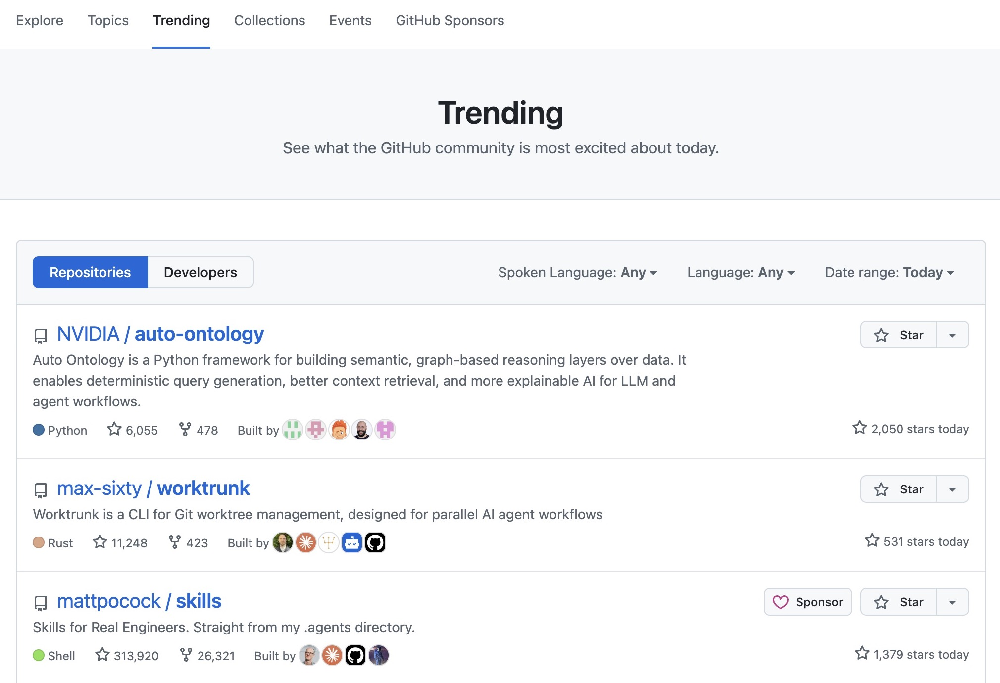
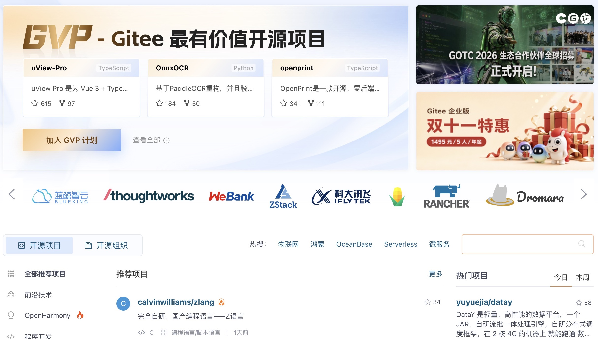
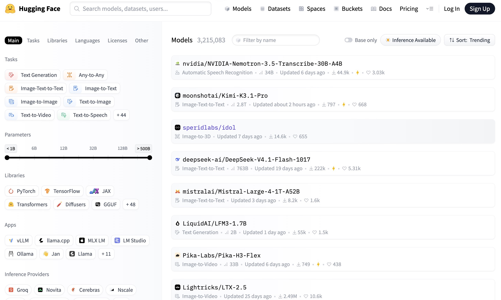

# 什么是开源平台

**开源平台**，即是公开源代码的数据托管平台，通常承载了各种不同的开源项目。

开源平台通常会设置许可证，避免开源内容滥用。

开源为什么重要？因为代码公开，任何人都可以**学习它、复用它、修复它、基于它继续开发**——我们每天使用的软件世界，很大程度上就是这样建成的。想了解许可证如何运作，可以看下一部分的 [选择许可证](../repo-management/license.md)。

开源其实无处不在：**Linux** 内核、**Android** 系统、**Chromium** 浏览器、**Python** 语言本身、**LLaMA** 模型……都是开源项目。在 GitHub 这样的平台上阅读它们的源码，是学习编程最好的方式之一。

## 经典（或者有用）的开源平台

- [GitHub](https://github.com/trending)——目前世界上最大、生态最好的开源社区平台。

    

- [Gitee](https://gitee.com/explore)——国内一个可行的 GitHub 替代平台。

    

- [Hugging Face](https://huggingface.co/models)——AI 模型的开源平台。

    

## 开源平台有哪些，GitHub 在其中的优势是什么

常见的代码托管 / 开源平台：

| 平台 | 特点 |
| --- | --- |
| **GitHub** | 全球最大、社区最活跃，生态最完善 |
| **GitLab** | 提供自托管（自己部署）方案，DevOps 一体化能力强 |
| **Bitbucket** | 由 Atlassian 出品，与 Jira 等工具集成好 |
| **Gitee（码云）** | 国内平台，访问速度快，中文社区 |
| **SourceForge** | 老牌开源项目托管站 |
| **GitCode** | 国内较新的开源托管平台 |

**GitHub 的核心优势：**

1. **社区规模最大**：几乎所有知名开源项目（如 Linux 相关资料、VS Code、React、Vue、TensorFlow 等）都托管在 GitHub 上，开发者、组织和公司高度聚集。
2. **"社交化编程"（Social Coding）**：通过 Star（收藏/点赞）、Fork（复刻）、Follow（关注）、PR 等方式，让代码和开发者都"可被发现、可被协作"。
3. **生态最丰富**：GitHub Actions（自动化）、GitHub Pages（免费网站托管）、GitHub Copilot（AI 编程助手）、Codespaces 等配套服务一应俱全。
4. **免费额度友好**：个人免费账号即可创建无限公开仓库（私有仓库也有限额），对个人学习和小型团队足够使用。
5. **事实上的标准**：`git` + GitHub 的用法几乎成为行业通行做法，找工作、参与开源、阅读优秀源码大多从 GitHub 开始。
