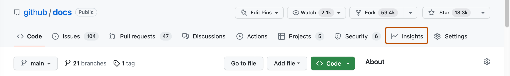
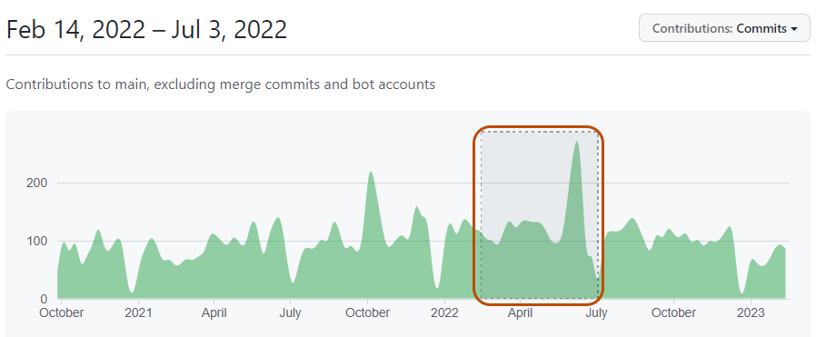
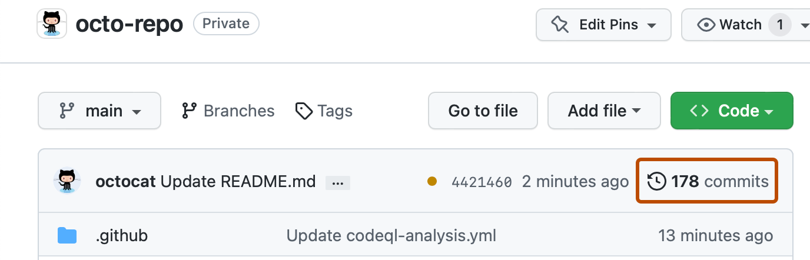
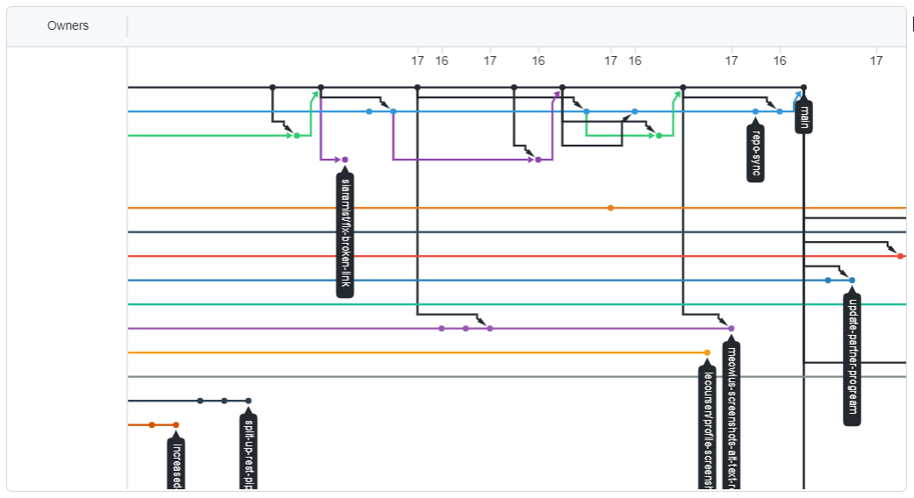

# 如何判断一个仓库现在的状态

"状态"主要指这个项目目前是**活跃、维护中，还是已经弃坑**。判断方法：观察 Insights 中的内容。

*下方 GitHub 官方文档截图用于展示界面；日期、数量和布局可能与当前网站有所不同。*

  1. **Pulse：检查这个仓库最近是否有人维护**

   Pulse 会汇总仓库近期的 Pull Request、Issue 和提交活动。若最近持续有人提交代码、处理问题，通常说明项目仍在活跃维护。

  2. **看 Contributors**

   Contributors 页面可以看到参与者数量及各自的贡献趋势。贡献者较多且近期仍有人持续贡献，说明项目的协作和维护相对健康。

   

  3. **看 commits**

   查看最近一次提交时间以及提交频率，判断代码是否还在更新。长期没有新提交可能表示项目已稳定，也可能已经停止维护，需要结合 Issue 和 Release 一起判断。

   

  4. **看 Network**

   Network 图展示仓库及其 Fork 之间的提交关系和分支变化。如果原仓库更新停滞，但某个 Fork 仍在活跃开发，可以进一步关注该 Fork。

   

  5. **看 Community 规范**

   Community 页面会显示项目是否提供贡献指南、行为准则（Code of Conduct）和 Issue/PR 模板。健康维护的项目通常都会认真准备这些——这也说明他们欢迎新贡献者。

!!! note "还有一个信号：Archived 标记"
    如果仓库被**归档（Archived）**，GitHub 会在页面上显示 "Archived" 横幅，并把仓库设为**只读**：你仍然可以查看和 fork 代码，但任何人都无法再提交或提 Issue。被归档意味着官方已经不再维护这个项目。

**实践环节：** 挑一个你感兴趣的仓库，用上面的方法判断它是否还在活跃维护，并简要说明你的理由。
