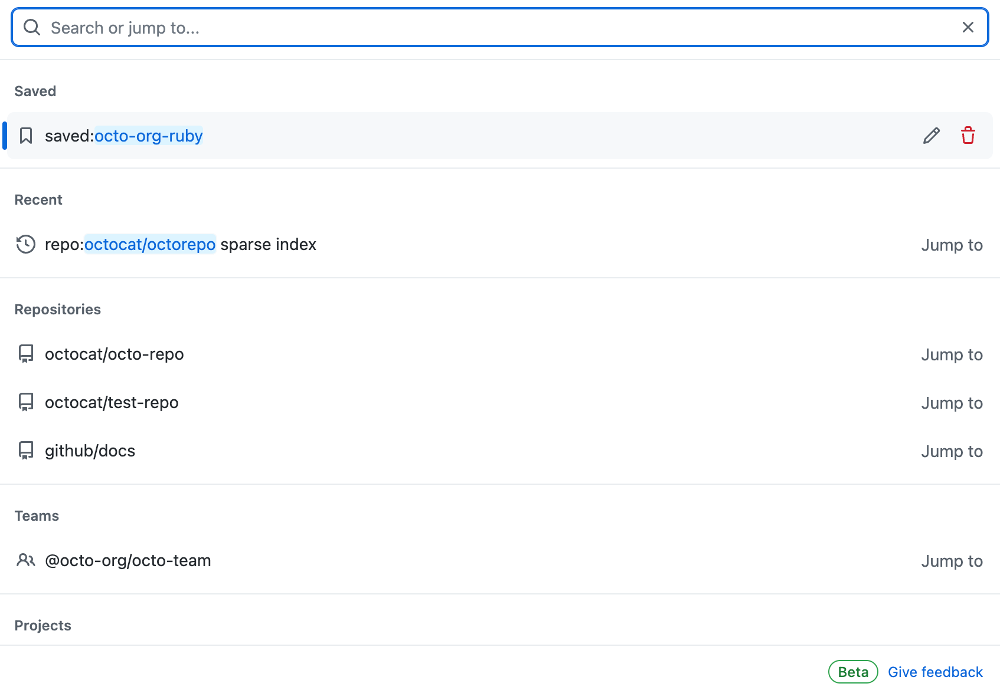

# 在 GitHub 上搜索

!!! warning
    搜索栏在上方，那个最大的输入框不是搜索栏

!!! tip
    那么这个最大的输入框是什么？实际上这是 GitHub Copilot，在这里你可以使用许多不同的先进模型（当然，前提是得付费）

*下方 GitHub 官方文档截图用于展示界面；日期、数量和布局可能与当前网站有所不同。*

!!! tip "用限定符缩小搜索范围"
    搜索时还可以使用限定符（qualifier），例如 `stars:>1000 language:python topic:machine-learning` 会返回关于机器学习的、Star 数超过 1000 的 Python 仓库。GitHub 提供了许多这样的限定符——先输入关键词，再使用侧边栏筛选或自动补全建议即可。

常用限定符：

| 限定符 | 示例 | 含义 |
| --- | --- | --- |
| `stars:` | `stars:>1000` | Star 数超过 1000 的仓库 |
| `language:` | `language:python` | 使用指定语言编写的仓库 |
| `topic:` | `topic:machine-learning` | 带有指定主题标签的仓库 |
| `user:` | `user:torvalds` | 某个用户名下的仓库 |
| `org:` | `org:github` | 某个组织名下的仓库 |
| `repo:` | `repo:torvalds/linux` | 只在指定仓库内搜索 |
| `pushed:` | `pushed:>2026-01-01` | 最近仍有推送更新的仓库（还活着吗？） |

!!! note
    还有两点：**代码搜索需要先登录 GitHub** 才能使用；结果列表上方有排序菜单，可以按 *Best match*（最佳匹配）、*Most stars*（最多 Star）或 *Recently updated*（最近更新）排序。

## 怎么评价一个仓库

面对一个陌生仓库，可以从以下几个维度快速评估它"值不值得用 / 学 / 参与"：

| 维度 | 在哪里看 | 说明 |
| --- | --- | --- |
| **Star 数** | 仓库主页右上角 ⭐ | 相当于"收藏/点赞"数，是受欢迎程度最直观的指标，一般越多越好 |
| **Fork 数** | Star 旁边 | 被复刻的次数，反映有多少人基于它做二次开发 |
| **Watch 数** | 仓库主页 | 关注人数，反映持续关注度 |
| **Issue 情况** | Issues 标签页 | 看 issue 数量、是否有维护者及时回复和处理；Issue 怎么用见 [用 Issue 反馈问题](../repo-management/issues.md) |
| **最近提交时间** | 文件列表 / Commits | 判断项目是否还在维护 |
| **Contributor 数量** | Insights → Contributors | 参与人数越多，说明协作越健康 |
| **License** | 仓库根目录 / 右侧 About | 决定你能不能用、怎么用这份代码 |
| **README 质量** | 仓库首页 | 是否有清晰的介绍、安装和使用说明 |
| **Release / Tag** | Releases 标签页 | 是否有稳定版本号，是否频繁发版 |
