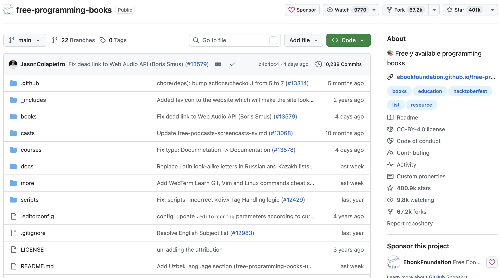
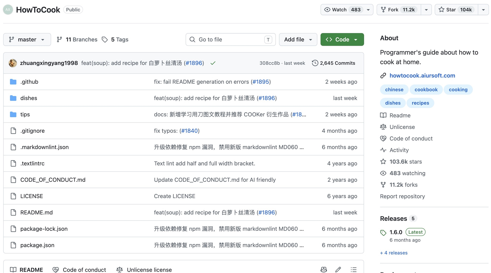
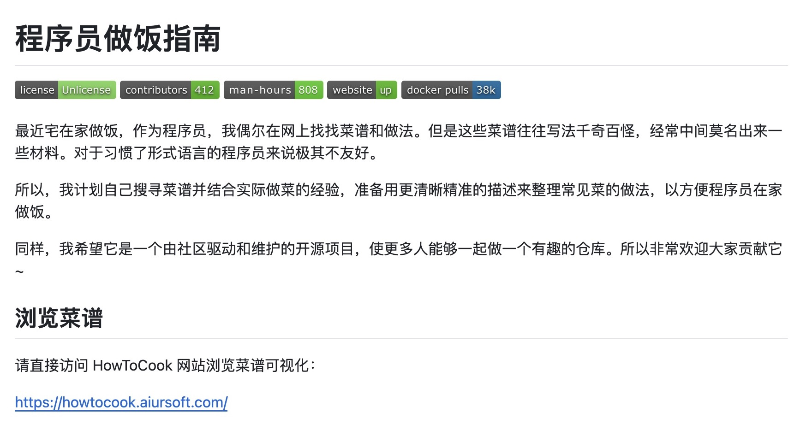
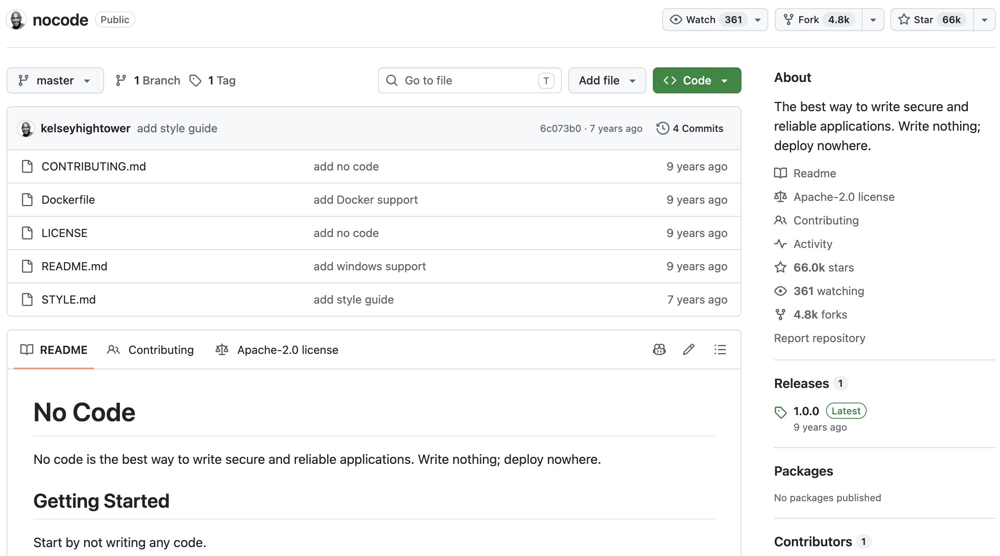
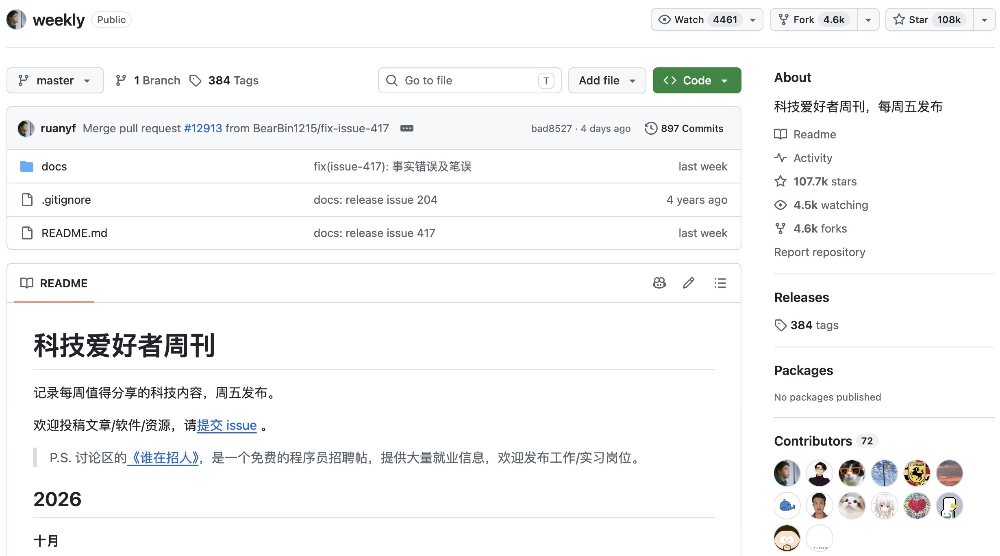
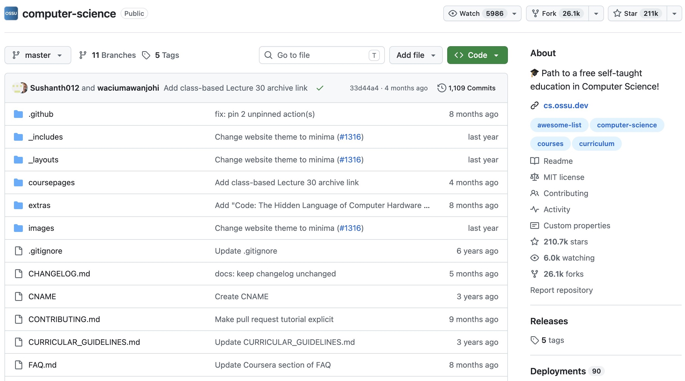

# GitHub 是什么

GitHub 是一个基于 **Git** 版本控制系统构建的代码托管与协作平台，于 2008 年上线，2018 年被微软收购。简单来说，它是一个"存放代码、和别人一起写代码"的网站。

今天它已经拥有超过 1 亿注册开发者，你在课程中会遇到的绝大多数开源项目都托管在这里。

!!! tip
    GitHub 与 Git 不同。GitHub 是一个开源平台，其仓库基于 Git。不过，你能在 GitHub 上找到一些意想不到的内容，即使它们与编程毫无关系。
    理论上，你可以放上任何你想分享的内容。

## 幕后的 Git

Git 是一个**分布式版本控制系统**，由 Linus Torvalds 于 2005 年创建。它运行在你自己的电脑上，记录你对文件的每一次改动。有了 Git，你可以：

- 随时回到任意一个历史版本（再也不需要 `作业_最终版_真的最终版.zip` 了）；
- 通过**分支（branch）**与别人并行开发，最后再把工作合并到一起。

下面几个术语会在后面反复出现：

| 术语 | 含义 |
| --- | --- |
| **仓库（Repository）** | 存放项目文件与历史记录的地方 |
| **提交（Commit）** | 一次改动的快照，就像游戏里的存档点 |
| **分支（Branch）** | 一条并行的开发线，默认分支通常叫 `main` |
| **远端（Remote）** | 托管在服务器上的仓库副本，比如 GitHub 上的那份 |

GitHub 就建立在 Git 之上：它托管远端仓库，并提供了网页界面和本 workshop 中你会看到的种种社区功能。

## 一些有趣的例子

- [Free Programming Books](https://github.com/EbookFoundation/free-programming-books)：由社区维护的免费编程书籍和学习资源合集。

    

- [HowToCook](https://github.com/Anduin2017/HowToCook)：程序员的居家做饭指南，提供清晰、分步骤的菜谱。

    

    

- [No Code](https://github.com/kelseyhightower/nocode)：一个以"不写代码，也不部署到任何地方"为主题的幽默项目。这个受欢迎的"空仓库"仍然包含 README 和其他文件。

    

- [科技爱好者周刊](https://github.com/ruanyf/weekly)：每周发布的科技资讯周刊，欢迎读者通过 Issues 投稿。

    

- [OSSU Computer Science](https://github.com/ossu/computer-science)：由社区组织的计算机科学自学课程体系。

    

## 不止是托管代码

除了托管代码，GitHub 还提供 **Issue（问题追踪）、Actions（自动化）、Pages（静态网站托管）、Wiki（文档）、Codespaces（云端开发环境）** 等功能，已经发展成一个完整的开发者社区和工程协作生态。
