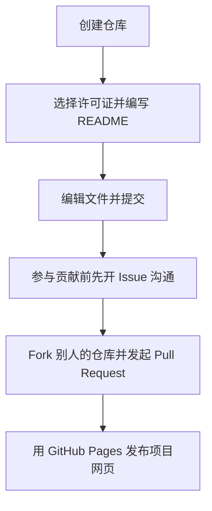

# GitHub 仓库的使用

> **作者：** 张峻铭

在[第一部分](../github-introduction/index.md)中，你已经了解了 GitHub 是什么，以及如何搜索、判断和下载仓库。现在轮到你自己动手：创建一个仓库并维护它，体验完整的开源协作流程。

开始之前，请先确认你已经有：

- 一个 GitHub 账号（见 [注册 GitHub 账号](../github-introduction/register-account.md)）；
- 电脑上安装好 Git，并且会用终端（Terminal）。

## 整体流程

一句话总结：

**先用[创建仓库](create-repository.md)建仓库 → 用[许可证](license.md)和 [README](readme.md) 把项目弄清楚 → 参与贡献前先[开 Issue](issues.md) 沟通 → [Fork](fork.md) 之后走 [Pull Request](contribute.md) 流程 → 平时小改动在[网页上编辑](edit-online.md) → 项目成熟后用 [GitHub Pages](github-pages.md) 搭个网页展示**。

## 完成本部分后

你将拥有：

- 一个属于自己的仓库，带许可证和 README；
- 一个用 GitHub Pages 发布的网页；
- 一个别人仓库的 fork（说不定还向它发起了 Pull Request）；
- 一份你自己提交的、写得很清楚的 Issue。

## 章节

- [创建仓库](create-repository.md)：创建你的第一个仓库，并把代码放进去。
- [选择许可证](license.md)：决定别人可以怎样使用你的代码。
- [用 Issue 反馈问题](issues.md)：仓库内置的"工单系统"，也是参与贡献的第一步。
- [Fork 一个仓库](fork.md)：把别人的仓库复制到你自己的账号下。
- [通过 Pull Request 参与贡献](contribute.md)：开源协作的核心流程。
- [在网页上快速编辑](edit-online.md)：不需要本地 Git 的小改动。
- [编写 README](readme.md)：你项目的"第一张名片"。
- [用 GitHub Pages 发布网页](github-pages.md)：把仓库变成一个免费网站。
